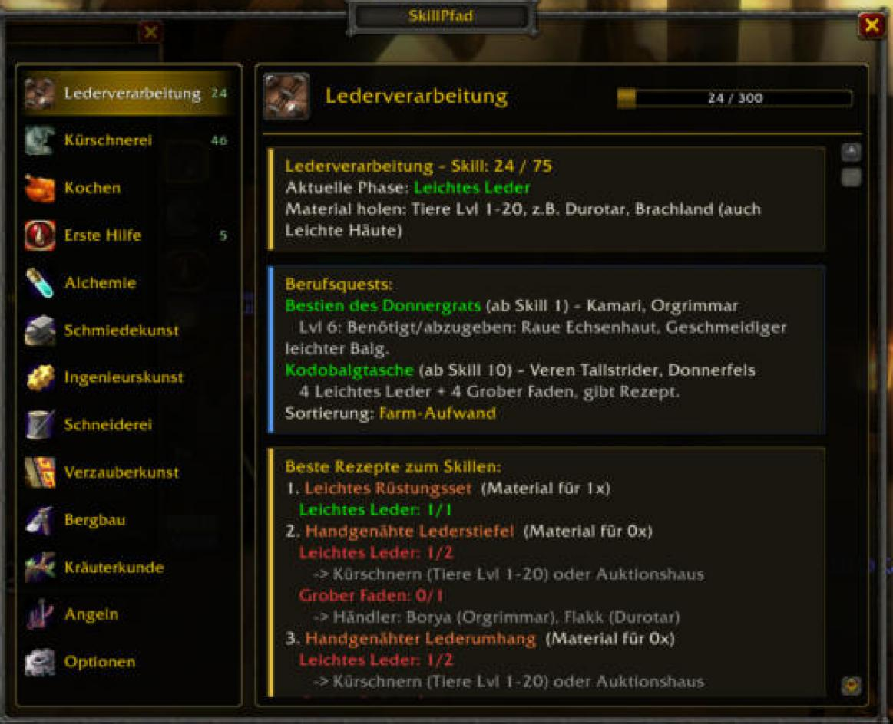
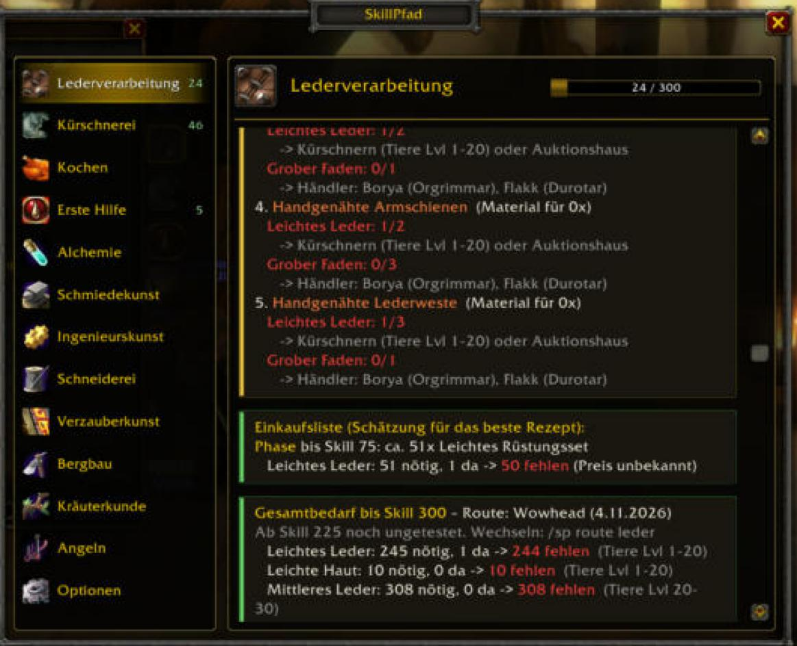
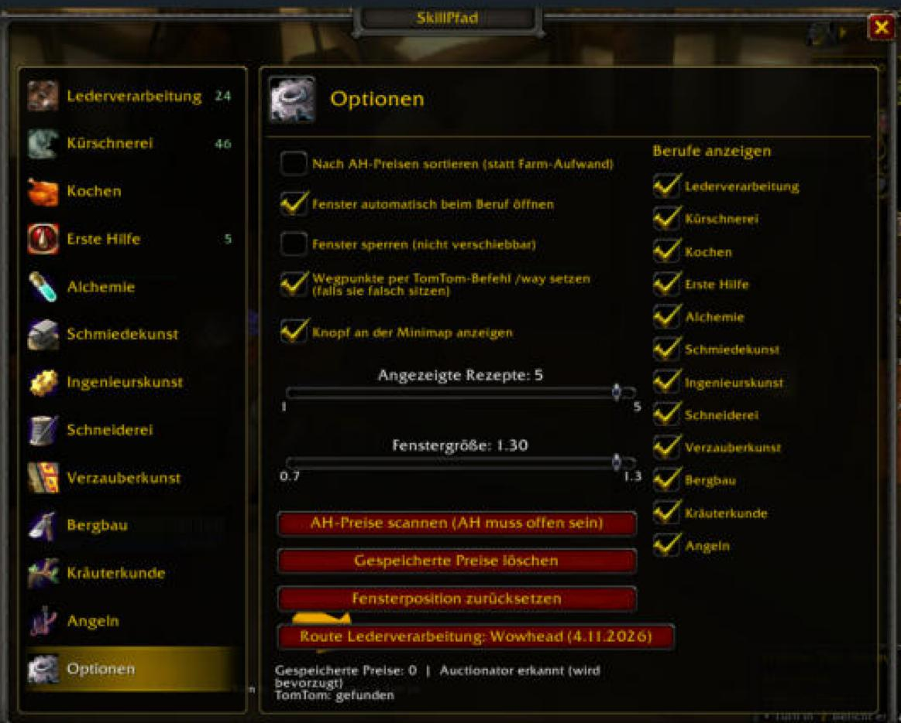

# SkillPfad

[Deutsche Version](README.md)

**Profession guide for WoW Forever (Classic ruleset).** For all 12 professions SkillPfad shows the best path from 1 to 300: which recipe to craft next, the materials needed, where to get them, their auction house price, and optionally sets TomTom waypoints. The UI is available in **English and German** (chosen by client language, switch with `/sp lang de|en|auto`).

| Shopping list & total needs | Options (switch professions on/off) |
|---|---|
|  |  |

## Features

- 12 professions (leatherworking, skinning, cooking, first aid, alchemy, blacksmithing, engineering, tailoring, enchanting, mining, herbalism, fishing).
- Phased skill path with recommended recipe, materials and notes.
- Sources and vendors with map coordinates, for **Horde and Alliance**.
- TomTom waypoints for materials, trainers, vendors and profession quests (Blizzard waypoint as fallback).
- Profession quests, with warnings before irreversible choices.
- Shopping list with costs (Auctionator or own scan) and **one-click export to an Auctionator shopping list**.
- Several routes per profession with cost comparison; gatherer/crafter pairings.
- Recommendations stay visible without the profession window (last known state), plus an "open profession" button.
- Switch professions on/off. Self-test with `/sp check`. Command overview with `/sp help` (slash keywords are German, e.g. `/sp leder`).

## Installation

1. Download the ZIP from [Releases](../../releases).
2. Copy the `SkillPfad` folder to `…/_forever_/Interface/AddOns/`.
3. Start the game or `/reload`. Optional: TomTom, Auctionator.

Commands: `/sp`, `/sp <profession>`, `/sp einst` (options), `/sp route`, `/sp scan`, `/sp preis`, `/sp weg`, `/sp mapcheck`, `/sp check`.

## Status

New addon. Verified in a mock environment but **not yet fully tested in game**. Some phases beyond skill 225 use unverified sources; some item or map IDs may be wrong. Please open an [issue](../../issues) with the output of `/sp check`.

## License

GPL-3.0 (quest/NPC data derived from [Questie](https://github.com/Questie/Questie), GPL-3.0). See [LICENSE](LICENSE) and [THIRD-PARTY.md](THIRD-PARTY.md). Not affiliated with Blizzard Entertainment.
