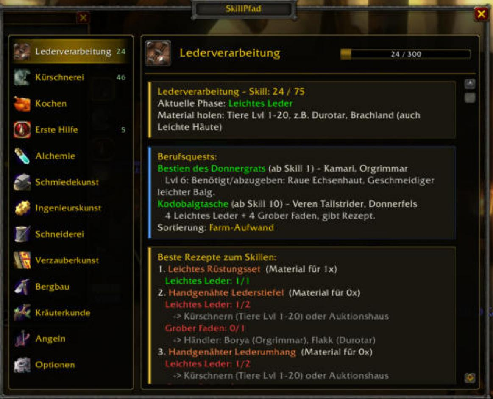
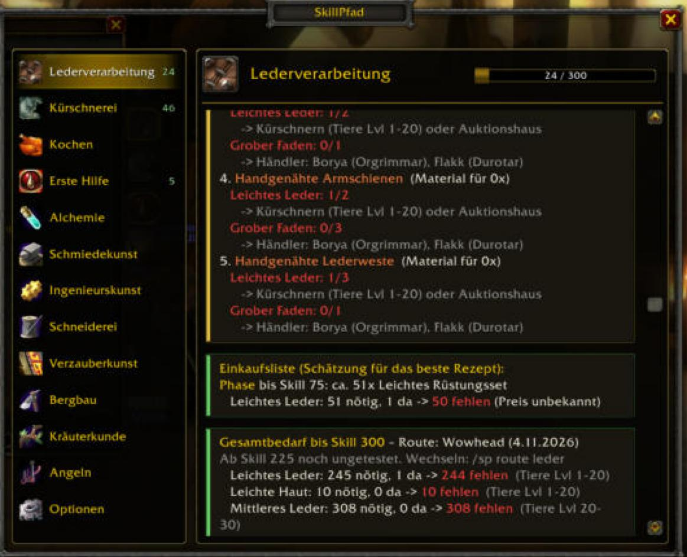
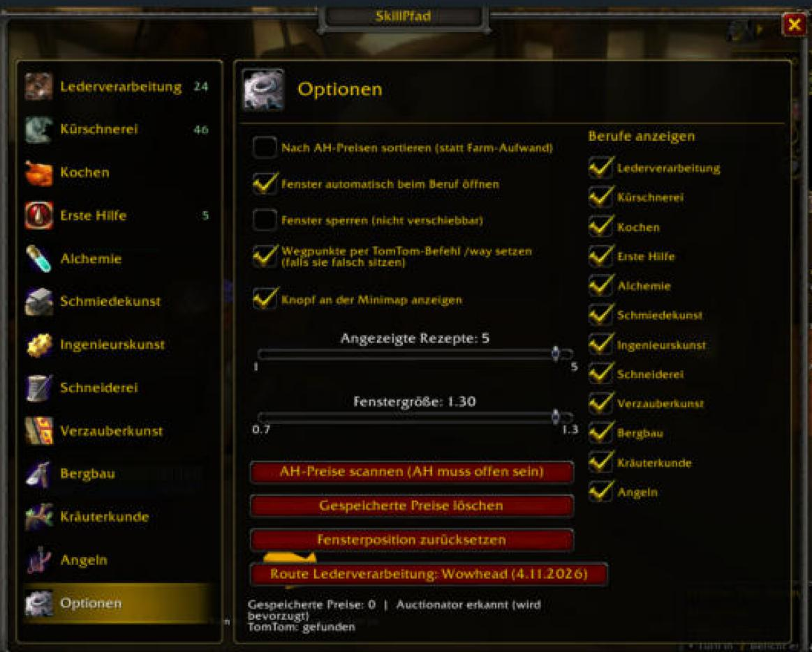

# SkillPfad

[English version](README.en.md)

**Berufs-Guide für WoW Forever (Classic-Regelwerk).** SkillPfad zeigt dir für alle 12 Berufe den besten Weg von 1 bis 300: welches Rezept du als Nächstes herstellst, welches Material du brauchst, wo du es bekommst, was es im Auktionshaus kostet – und setzt auf Wunsch TomTom-Wegpunkte.

| Einkaufsliste & Gesamtbedarf | Optionen (Berufe ein-/ausschalten) |
|---|---|
|  |  |

## Funktionen

- **12 Berufe:** Lederverarbeitung, Kürschnerei, Kochen, Erste Hilfe, Alchemie, Schmiedekunst, Ingenieurskunst, Schneiderei, Verzauberkunst, Bergbau, Kräuterkunde, Angeln.
- **Skill-Weg in Phasen** mit empfohlenem Rezept, Material und Hinweisen (Daten u. a. aus Wowhead-Guides).
- **Fundorte & Händler** mit Karten-IDs und Koordinaten, für **Horde und Allianz**.
- **TomTom-Wegpunkte** für Material, Trainer, Händler und Berufsquests (ohne TomTom: Blizzard-Wegpunkt).
- **Berufsquests** mit Hinweis, wenn eine Entscheidung nicht rückgängig zu machen ist.
- **Einkaufsliste mit Kosten** (Preise aus Auctionator oder eigenem Scan) und **Übergabe an Auctionator** als Einkaufsliste per Klick.
- **Mehrere Routen** pro Beruf mit Kostenvergleich; **Paarungen** wie Bergbau ↔ Schmiedekunst, Kräuterkunde ↔ Alchemie, Angeln ↔ Kochen.
- **Berufe ein-/ausschalten**, wenn du nicht alles skillst.
- **Empfehlungen auch ohne offenes Berufsfenster** (letzter Stand) und Knopf „Beruf öffnen“.
- **Deutsch und Englisch:** automatisch nach Client-Sprache, umschaltbar mit `/sp lang de|en|auto`.
- **Selbsttest** mit `/sp check`, Befehlsübersicht mit `/sp help`.

## Installation

1. ZIP von der [Releases-Seite](../../releases) laden (oder dieses Repo klonen).
2. Den Ordner `SkillPfad` nach `…/_forever_/Interface/AddOns/` kopieren, sodass `…/AddOns/SkillPfad/SkillPfad.toc` existiert.
3. Spiel starten (oder `/reload`). Optional: **TomTom** und **Auctionator** installieren.

Ausführliche Hilfe: [docs/ANLEITUNG.md](docs/ANLEITUNG.md).

## Befehle

| Befehl | Wirkung |
|---|---|
| `/sp` | Fenster öffnen/schließen |
| `/sp <beruf>` | Beruf öffnen (z. B. `leder`, `schmied`, `alchemie`) |
| `/sp einst` | Einstellungen (inkl. Berufe ein-/ausschalten) |
| `/sp route [beruf]` | nächste Route des Berufs wählen |
| `/sp scan` | AH-Preise scannen (AH offen) |
| `/sp preis` | Sortierung nach AH-Preis ↔ Farm-Aufwand |
| `/sp weg …` | Wegpunkt per Befehl setzen |
| `/sp mapcheck` | Karten-IDs prüfen |
| `/sp check` | Selbsttest (Version, Daten, TomTom, Auctionator, …) |

## Status

Das Addon ist neu. Daten und Oberfläche sind im Testaufbau geprüft, aber **noch nicht vollständig im Spiel**. Manche Phasen ab Skill 225 beruhen auf nicht überprüften Quellen, einzelne Item-IDs und Karten-IDs können falsch sein. Fehler bitte als [Issue](../../issues) melden, am besten mit der Ausgabe von `/sp check`.

Bekannte Lücken: Verkäufer des Machtfisch-Steak-Rezepts (Allianz), Thorium-Widget-Schema (Allianz), Mengen der Schneiderei 205–234, Alchemie „Murlocauge“.

## Quellen & Lizenz

- Quest- und NPC-Daten stammen aus der Datenbank des Addons [Questie](https://github.com/Questie/Questie) (GPL-3.0). SkillPfad steht daher ebenfalls unter **GPL-3.0** (siehe [LICENSE](LICENSE)).
- Guide-Inhalte orientieren sich an Wowhead; es werden keine Texte kopiert.
- Mehr in [THIRD-PARTY.md](THIRD-PARTY.md).

Nicht von Blizzard Entertainment unterstützt oder verbunden. World of Warcraft ist eine Marke von Blizzard Entertainment.
